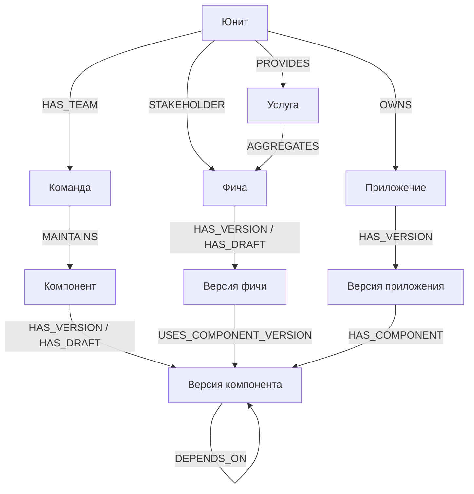

# Глоссарий

## Сущности

**Юнит (Unit)** - Бизнес-подразделение (организационный контур). В пределах юнита живут команды, услуги, приложения, фичи и компоненты.

### Команда (Team)

Группа внутри юнита. Сопровождает компоненты связью `MAINTAINS`.

### Услуга (Service)

Агрегат фич юнита — набор функционалов для ценности пользователю. Состав задаётся связями `AGGREGATES`. **Не версионируется** (нет `ServiceVersion`). Статус: `active` | `archive`.

### Фича (Feature)

Функционал в рамках юнита. Одновременно могут существовать черновик следующей версии и опубликованная линия (гибрид «намерение + доставленное»).

### Версия фичи (FeatureVersion)

Версия функционала. Связывает версии компонентов через `USES_COMPONENT_VERSION`. Опубликованная версия в статусе `active` трактуется как **эпик** (обобщение доработки по компонентам). Статус версии фичи показывает готовность функционала как бизнес-намерения; смена статуса не затрагивает компоненты и релизы приложений.

### Приложение (Application)

Deployment-единица (поставляемый артефакт). Юнит владеет приложением через `OWNS`.

### Версия приложения (ApplicationVersion)

Релиз приложения. Состав версий компонентов задаётся рёбрами `HAS_COMPONENT`. Статусы: `current` (текущий прод-релиз) и `previous` (история). Черновика у приложения нет.

### Компонент (Component)

Единица кода **или** управляемая внешняя зависимость (`type ∈ { component, dependency }`). Поле `isPublic` задаётся при создании и определяет, можно ли использовать контракт во внешних (cross-unit) сценариях. Классификация и `isPublic` после создания не меняются.

### Версия компонента (ComponentVersion)

Версия контракта компонента. Участвует в составе релизов приложений и в привязках фич. Публичность для cross-unit берётся с родительского `Component`.

## Связи

Все типы рёбер — `SNAKE_CASE`.

| Ребро | Тип | Направление | Назначение |
| ----- | --- | ----------- | ---------- |
| `HAS_TEAM` | организационная | Юнит → Команда | Команда в юните |
| `OWNS` | организационная | Юнит → Приложение | Владение приложением |
| `PROVIDES` | организационная | Юнит → Услуга | Услуга юнита |
| `STAKEHOLDER` | организационная | Юнит → Фича | Владение фичей |
| `MAINTAINS` | организационная | Команда → Компонент | Команда сопровождает компонент |
| `AGGREGATES` | композиционная | Услуга → Фича | Состав услуги |
| `HAS_VERSION` | композиционная | родитель → `*Version` | Опубликованная версия сущности |
| `HAS_DRAFT` | композиционная | родитель → `*Version` | Черновик версии сущности |
| `INHERITED` | композиционная | `*Version` → `*Version` | Линейная история версий |
| `HAS_COMPONENT` | композиционная | Версия приложения → Версия компонента | Состав релиза; на ребре `status ∈ { active, deprecated }` |
| `USES_COMPONENT_VERSION` | композиционная | Версия фичи → Версия компонента | Компонент в составе фичи; на ребре `applicationId` (приложение-контекст) |
| `PINNED_TO_APPLICATION_VERSION` | композиционная | Версия фичи → Версия приложения | Снимок релиза приложения на момент публикации фичи |
| `DEPENDS_ON` | композиционная | Версия компонента → Версия компонента | Зависимость по контрактам (направленная; допускаются две противоположные связи между одной парой версий) |

### Заметки по связям

- При снятии фичи с услуги ребро `AGGREGATES` не удаляется: выставляется `deleted: true` (история состава).
- Связь «фича ↔ фича» или «услуга ↔ услуга» отдельными рёбрами не моделируется: она проецируется из `USES_COMPONENT_VERSION`, `DEPENDS_ON` и контекста на `DEPENDS_ON`.
- Между одной парой версий компонентов допустимы две направленные `DEPENDS_ON` (`A→B` и `B→A`) — два контракта, не одна двусторонняя линия.

## Статусы версий

### Версия компонента и версия фичи

| Статус | Краткий смысл |
| ------ | ------------- |
| `draft` | Черновик; не на проде |
| `active` | Актуальная линия на проде (у фичи — опубликованный эпик) |
| `deprecated` | На проде как устаревшая линия; рекомендуется миграция |
| `unactive` | Снята с прода; история и анализ |

У версии компонента глобальный статус **производный** от прикладных статусов на рёбрах `HAS_COMPONENT` во всех `current`-релизах приложений.

У версии фичи статус задаёт жизненный цикл функционала и **не** выводится из релизов приложений: смена статуса фиксирует только состояние самой фичи.

### Версия приложения

| Статус | Краткий смысл |
| ------ | ------------- |
| `current` | Текущий прод-релиз (у приложения ровно один) |
| `previous` | Выпущенный, но уже не текущий релиз |

## Понятия

### Пересечение юнитов (cross-unit)

Зависимости `DEPENDS_ON` между версиями компонентов **разных** юнитов. У поставщика для внешней экспозиции нужен `Component.isPublic = true`.

### Анализ влияния (Impact)

Запросы, показывающие, какие сущности затронуты изменением выбранной ноды (юнит, команда, услуга, фича, приложение, компонент, версия компонента).

### Готовность к публикации (`readyToProduction`)

Вычисляемый признак у версии фичи: можно ли публиковать черновик. Учитывает исходящие cross-unit `DEPENDS_ON` состава.

### Автопубликация (`canAutoActive`)

Разрешение автоматического перехода версии фичи `draft → active` при выполнении критерия готовности.

### Проекция диаграммы (`projection`)

Режим среза данных на диаграммах. Например, `draft` на диаграмме услуги показывает историю снятых `AGGREGATES`; operational-срезы опираются на прод-состояние.

### Релиз приложения

Фиксация нового `ApplicationVersion(current)` с составом `HAS_COMPONENT`. Через релиз обновляются прикладные и глобальные статусы версий компонентов.

