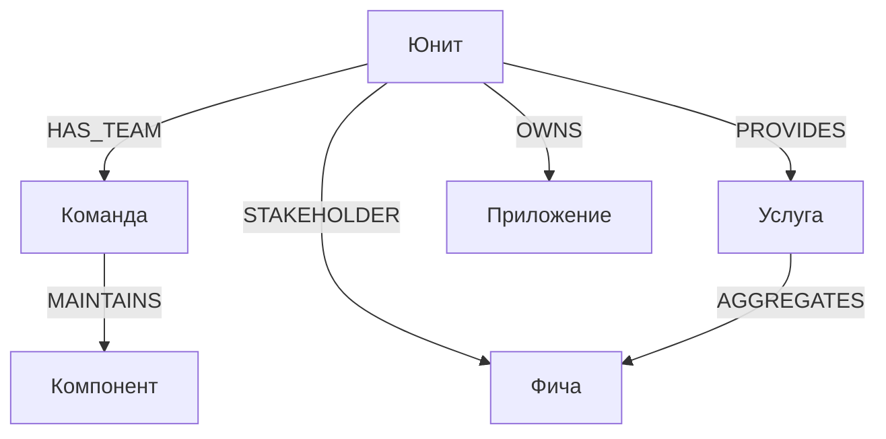

# Глоссарий

## Сущности

**Юнит (Unit)** - Бизнес-подразделение/тенант, аггрегирующая сущность для других (команды, услуги, приложения, фичи и компоненты и т.д.).

**Команда (Team)** - команда разработки внутри юнита.

**Фича (Feature)** - функционал разрабатываемый юнитом, может предоставляться другим юнитам в рамках услуги.

**Версия фичи (FeatureVersion)** - версия функционала.

**Услуга (Service)** - набор фич юнита.

**Приложение (Application)** - единица развертывания, поставляемый артефакт. Состоит из набора версий компонентов.

**Версия приложения (ApplicationVersion)** - набор компонентов соответствующих релизу приложения.

**Компонент (Component)** - модуль в коде или управляемый модуль в вендорской системе.

**Версия компонента (ComponentVersion)** - конкретная версия контракта компонента.

## Связи сущностей

Есть два типа связей:
- **Организационная** - связь, которая показывает владение одной сущностью другой.
- **Композиционная** - связь, которая показывает отношение одной сущности с другой в рамках процесса разработки.

### Организационная

| Ребро |  Направление | Назначение |
| ----- |  ----------- | ---------- |
| `HAS_TEAM`  | Юнит → Команда | Команда в юните |
| `OWNS`  | Юнит → Приложение | Владение приложением |
| `PROVIDES`  | Юнит → Услуга | Услуга юнита |
| `STAKEHOLDER`  | Юнит → Фича | Владение фичей |
| `MAINTAINS`  | Команда → Компонент | Команда сопровождает компонент |
| `AGGREGATES`  | Услуга → Фича | Состав услуги |

### Композиционная

| Ребро  | Направление | Назначение |
| ----- | ----------- | ---------- |
| `HAS_VERSION`  | родитель → `*Version` | Опубликованная версия сущности |
| `HAS_DRAFT`  | родитель → `*Version` | Черновик версии сущности |
| `INHERITED`  | `*Version` → `*Version` | Линейная история версий |
| `HAS_COMPONENT`  | Версия приложения → Версия компонента | Состав релиза; на ребре `status ∈ { active, deprecated }` |
| `USES_COMPONENT_VERSION`  | Версия фичи → Версия компонента | Компонент в составе фичи; на ребре `applicationId` (приложение-контекст) |
| `PINNED_TO_APPLICATION_VERSION`  | Версия фичи → Версия приложения | Снимок релиза приложения на момент публикации фичи |
| `DEPENDS_ON`  | Версия компонента → Версия компонента | Зависимость по контрактам (направленная; допускаются две противоположные связи между одной парой версий) |

### Заметки по связям

- При снятии фичи с услуги ребро `AGGREGATES` не удаляется: выставляется `deleted: true` (история состава).
- Связь «фича ↔ фича» или «услуга ↔ услуга» отдельными рёбрами не моделируется: она проецируется из `USES_COMPONENT_VERSION`, `DEPENDS_ON` и контекста на `DEPENDS_ON`.
- Между одной парой версий компонентов допустимы две направленные `DEPENDS_ON` (`A→B` и `B→A`) — два контракта, не одна двусторонняя линия.

## Статусы версий

### Версия компонента и версия фичи

| Статус | Краткий смысл |
| ------ | ------------- |
| `draft` | Черновик; не на проде |
| `active` | Актуальная линия на проде (у фичи — опубликованный эпик) |
| `deprecated` | На проде как устаревшая линия; рекомендуется миграция |
| `unactive` | Снята с прода; история и анализ |

У версии компонента глобальный статус **производный** от прикладных статусов на рёбрах `HAS_COMPONENT` во всех `current`-релизах приложений.

У версии фичи статус задаёт жизненный цикл функционала и **не** выводится из релизов приложений: смена статуса фиксирует только состояние самой фичи.

### Версия приложения

| Статус | Краткий смысл |
| ------ | ------------- |
| `current` | Текущий прод-релиз (у приложения ровно один) |
| `previous` | Выпущенный, но уже не текущий релиз |

## Понятия

### Пересечение юнитов (cross-unit)

Зависимости `DEPENDS_ON` между версиями компонентов **разных** юнитов. У поставщика для внешней экспозиции нужен `Component.isPublic = true`.

### Анализ влияния (Impact)

Запросы, показывающие, какие сущности затронуты изменением выбранной ноды (юнит, команда, услуга, фича, приложение, компонент, версия компонента).

### Готовность к публикации (`readyToProduction`)

Вычисляемый признак у версии фичи: можно ли публиковать черновик. Учитывает исходящие cross-unit `DEPENDS_ON` состава.

### Автопубликация (`canAutoActive`)

Разрешение автоматического перехода версии фичи `draft → active` при выполнении критерия готовности.

### Проекция диаграммы (`projection`)

Режим среза данных на диаграммах. Например, `draft` на диаграмме услуги показывает историю снятых `AGGREGATES`; operational-срезы опираются на прод-состояние.

### Релиз приложения

Фиксация нового `ApplicationVersion(current)` с составом `HAS_COMPONENT`. Через релиз обновляются прикладные и глобальные статусы версий компонентов.
