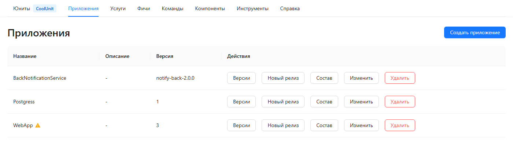
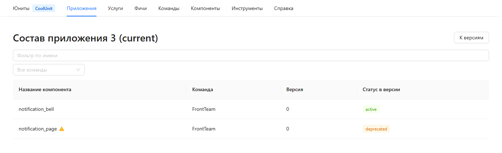
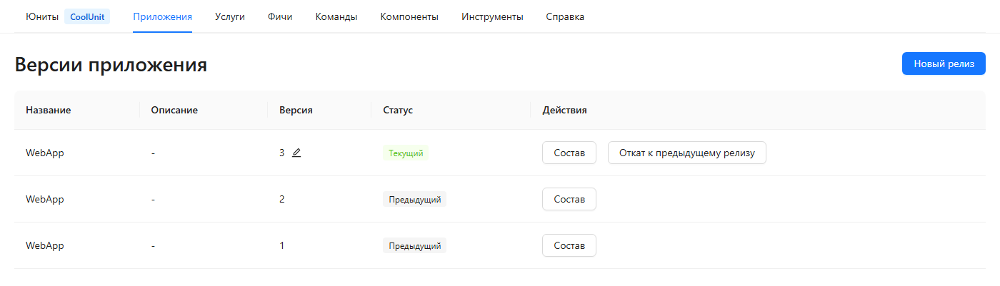
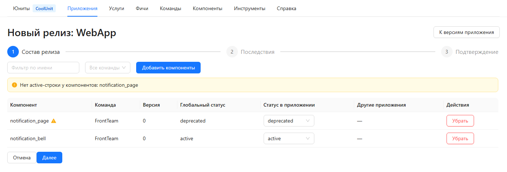

# Релиз приложения

Релиз задаёт текущий состав приложения: какие версии компонентов в нём и с каким статусом. Черновика версии приложения нет: выпуск идёт через визард **«Новый релиз»**.

На демо удобно смотреть **WebApp** и **BackNotificationService** в юните **CoolUnit**: у них есть текущая версия и история.

## Предусловия

Основной юнит — **CoolUnit** ([быстрый старт](../quick-start.md)). Данные демо не менялись (`npm run db:reset`, если граф уже правили).

## Список приложений

1. Откройте **«Приложения»**.
2. В колонке **«Версия»** — метка текущего релиза. Если текущей нет, но история есть, показывается последняя метка с пометкой **«Неактивна»**.
3. В строке есть **«Новый релиз»** и **«Состав»**.
4. Жёлтый треугольник у названия значит: в текущем релизе есть устаревшая строка состава или на приложение ссылается неактивная версия компонента. Клик открывает подробности. Подробнее — в [диаграммах](./diagrams.md).

## Состав текущего релиза

1. В строке приложения нажмите **«Состав»**.
2. Откроется таблица: компонент, команда, версия, статус в этом релизе (`active` или `deprecated`).
3. Таблица только для просмотра. Добавление и снятие строк — в визарде нового релиза.

## Страница версий

1. Откройте приложение по названию (например **WebApp**).
2. В шапке — **«Новый релиз»**.
3. У строки со статусом **current**, если версий больше одной, есть **«Откат к предыдущему релизу»**.
4. В ячейке версии у **current** — карандаш **«Переименовать версию»**. У прошлых релизов карандаша нет.
5. **«Состав»** в строке открывает состав именно этой версии.

## Визард нового релиза

1. Нажмите **«Новый релиз»**.
2. Шаг **«Состав релиза»**: строки текущего релиза, фильтры по имени и команде, выбор более новой версии компонента, статус в приложении, **«Убрать»**, **«Добавить компоненты»**.
3. Шаг последствий показывает, что изменится в этом приложении и глобально. Если есть последствия, для перехода дальше нужен чекбокс **«Я понимаю последствия»**.
4. На подтверждении задаётся метка версии и сводка. Кнопка **«Выпустить»** создаёт новый текущий релиз и переводит предыдущий в историю.

На демо визард можно открыть и посмотреть шаг состава, не нажимая **«Выпустить»**.

## Изменение данных

Эти действия меняют граф. Ниже только порядок кнопок, без снимков после изменения.

- **Выпустить** — подтверждение на последнем шаге визарда.
- **Переименовать версию** — карандаш у **current**, поле **«Версия»**, сохранение в модалке.
- **Откат к предыдущему релизу** — кнопка у **current**, модалка последствий, подтверждение. Создаётся новая текущая версия со снимком предыдущего состава. Если версия приложения единственная, кнопки отката нет.

После таких действий демо возвращается командой `npm run db:reset`.

## Связанные статьи

- [Фича и состав](./feature.md)
- [Диаграммы и impact](./diagrams.md)
