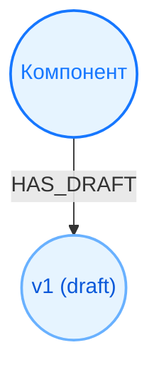
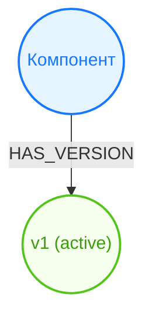
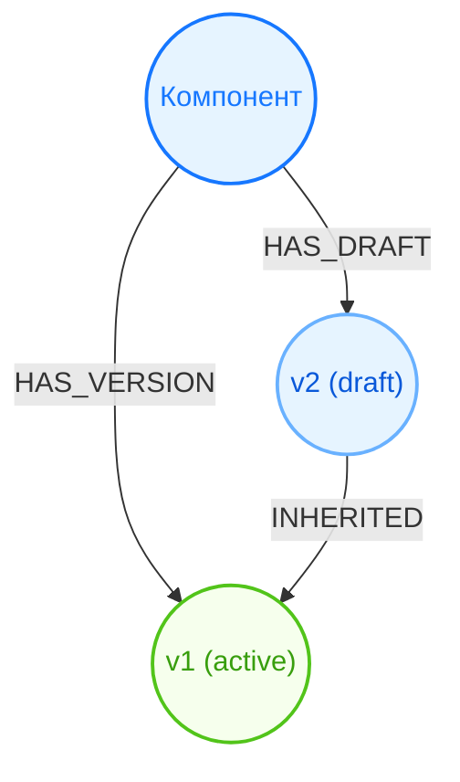
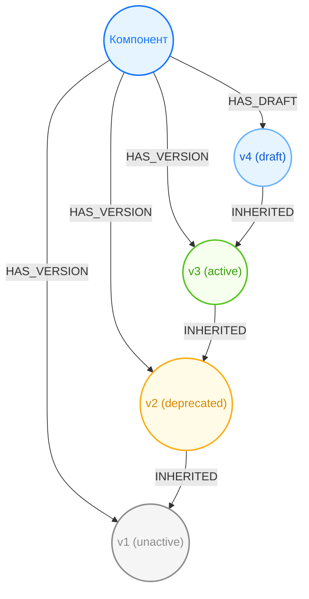
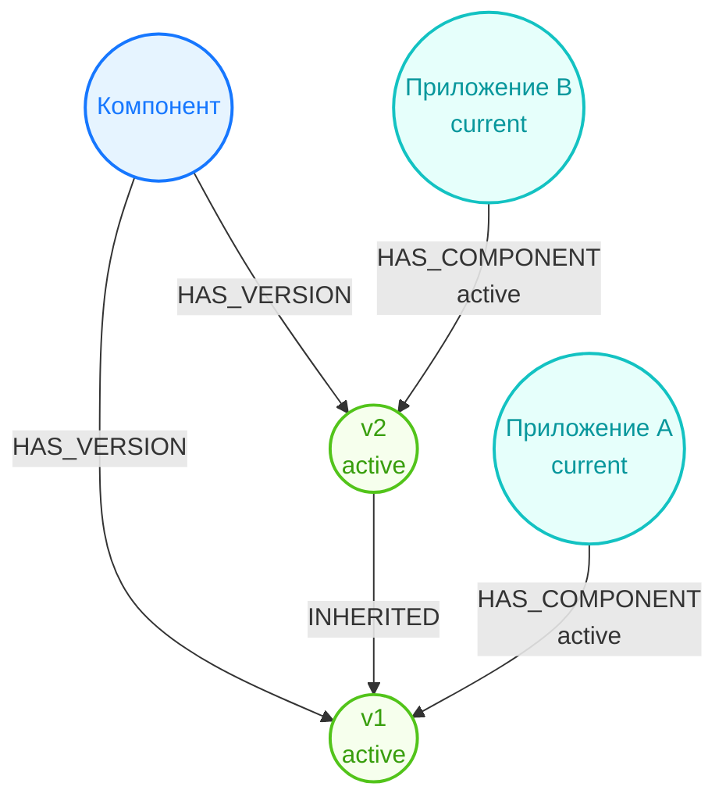
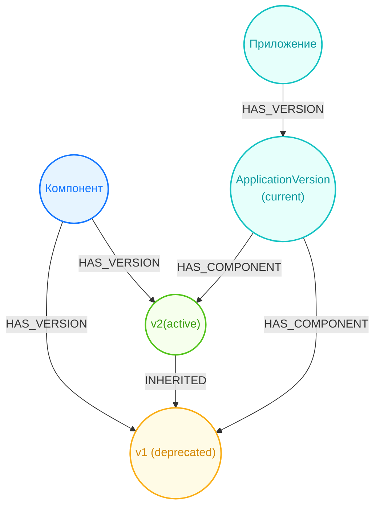

# Компонент и версии

**Компонент** — модуль в коде (класс, service, controller), отвечающий за реализацию конкретной бизнес-логики, или управляемый модуль (например, набор таблиц в инстансе postgress) в вендорской системе.

**Версия компонента** — конкретная версия контракта компонента.

## Версионирование компонента

При создании компонента автоматически создаётся первая `ComponentVersion` со статусом `draft`.

> [!WARNING]
> У компонента одновременно допустима только одна `draft`. Публикация `draft → active` выполняется только в визарде релиза приложения.

После релиза приложения, в котором эта версия вошла в состав, черновик публикуется: `draft → active`. Связь меняет тип с `HAS_DRAFT` на `HAS_VERSION`.

Новая draft версия наследуется от последней версии, с максимальным `versionNumber` среди всех версий приложения. Создается связь `INHERITED` от новой к предыдущей. У **компонента** одновременно могут быть несколько `HAS_VERSION` и один `HAS_DRAFT`.

### Полная статустная модель компонента

Статусы `active` / `deprecated` / `unactive` задаются релизами приложений, на схеме нижу указан только полный набор связей.

## 6. Несколько опубликованных линий

После публикаций у компонента остаётся каталог всех `HAS_VERSION`. Появление новой версии **не** переводит предыдущую в `unactive` само по себе. У компонента **допускается несколько глобально `active`** одновременно — если разные приложения держат разные линии. Инвариант «одна `active`» действует только внутри состава одного релиза приложения.

В релизе можно взять любую **более позднюю** версию по цепочке `INHERITED` без обязательного выпуска промежуточных релизов для каждой ступени.

### Миграция версий в одном приложении

В одном приложении допустимы несколько версий одного компонента, например одна версия `active` для новых пользователей и `deprecated` для старых.

### Статус unactive

Глобальный `unactive` появляется только после пересчёта состояния, то есть версии нет ни в одном приложении в статусе `current`.