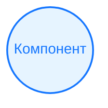
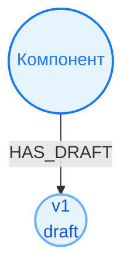
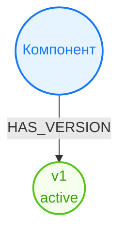
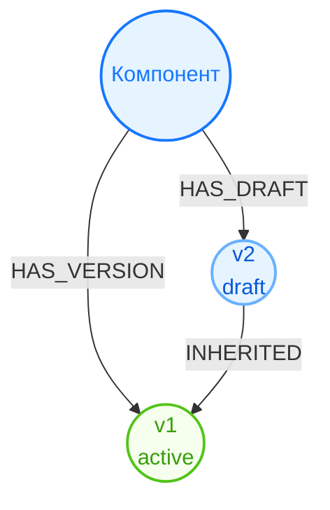
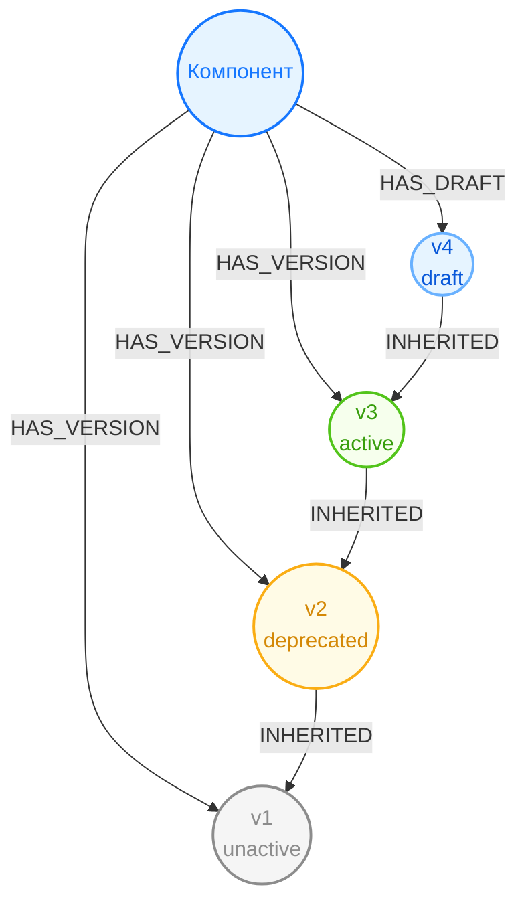
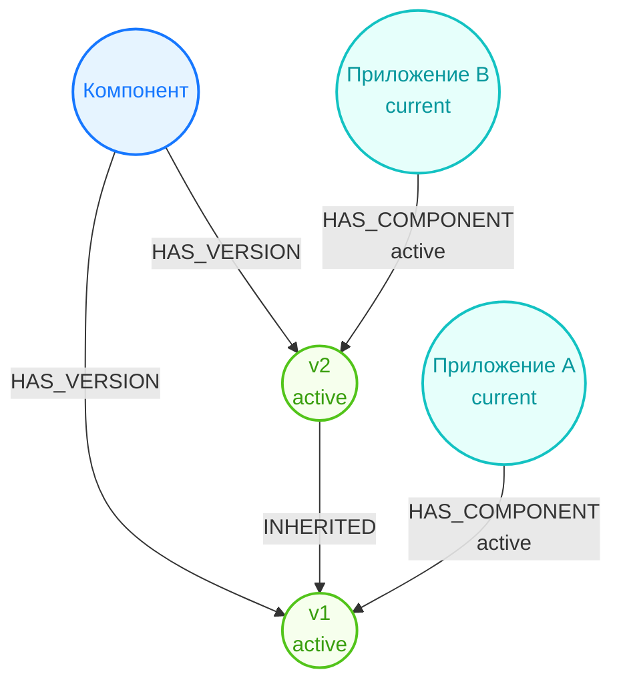
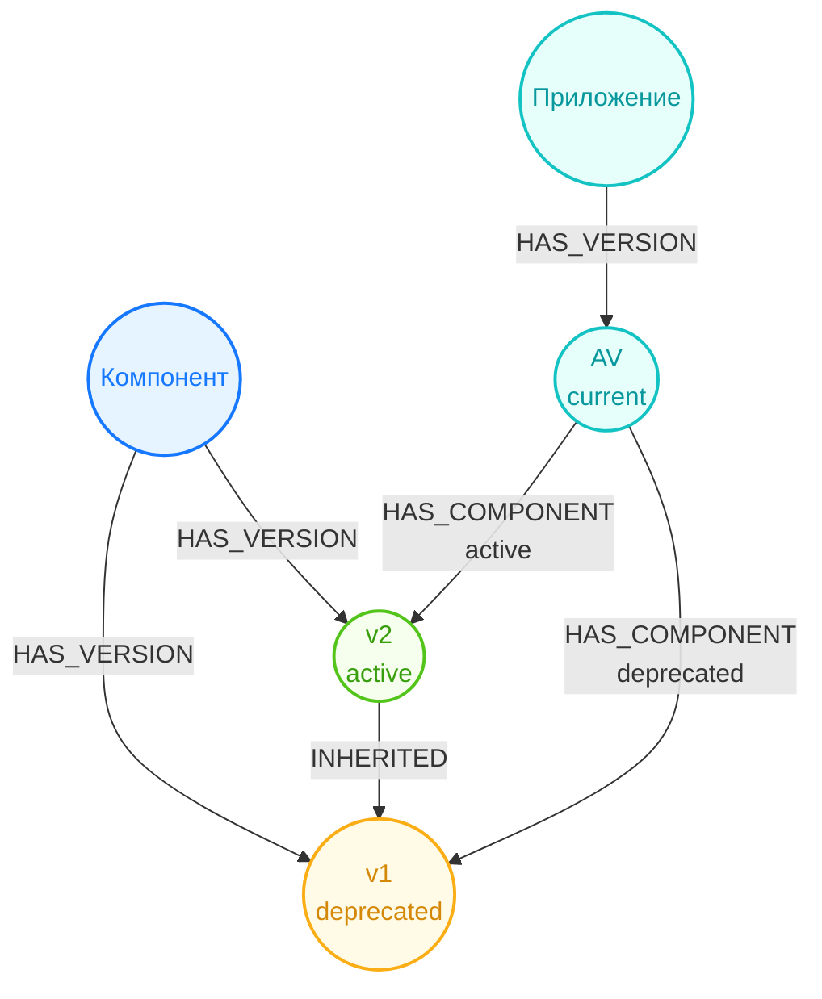
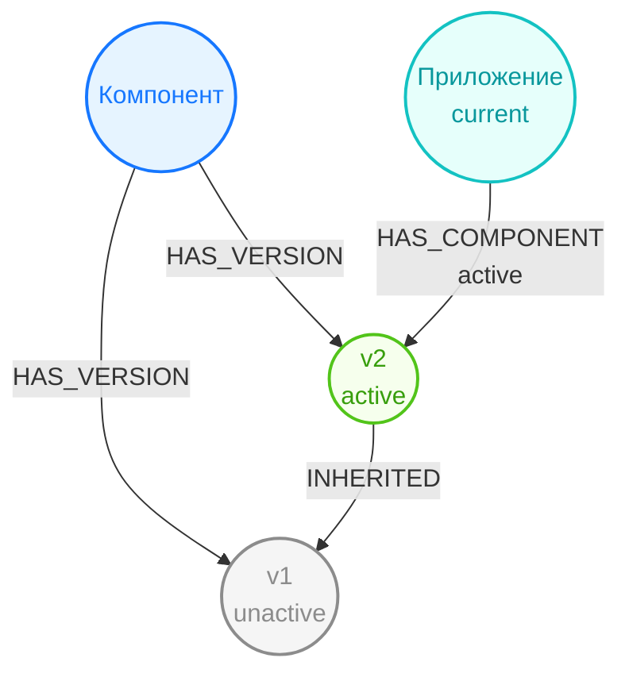

# Компонент и версии

**Компонент** — модуль в коде или управляемый модуль в вендорской системе.  
**Версия компонента** — конкретная версия контракта. Цепочка версий линейная (`INHERITED`), без ветвления.

У компонента одновременно допустима только одна `draft`. Глобальный статус опубликованной версии **производный**: его задаёт состав текущих релизов приложений (`HAS_COMPONENT`), а не ручная смена на странице компонента. Публикация `draft → active` выполняется только в визарде релиза приложения.

Цвета на схемах — палитра Ant Design: компонент (синий), `draft` (голубой), `active` (зелёный), `deprecated` (золотой), `unactive` (серый), приложение (бирюзовый).

## 1. Только компонент

Нода без версий — логическая точка старта. В продукте при создании компонента сразу появляется первая версия-черновик.

## 2. Первая версия (черновик)

При создании компонента автоматически создаётся первая `ComponentVersion` со статусом `draft`. Предшественника нет — ребра `INHERITED` ещё нет. Черновик висит на `HAS_DRAFT`.

## 3. Публикация первой линии

После релиза приложения, в котором эта версия вошла в состав, черновик публикуется: `draft → active`. Учёт переходит с `HAS_DRAFT` на `HAS_VERSION`.

## 4. Новая draft поверх опубликованной

Пока есть `draft`, вторую не создают. Новая draft строится от **версии-базы**: максимальный `versionNumber` среди `active` / `deprecated` (если таких нет — среди всех опубликованных, включая `unactive`). Связь истории — `INHERITED` от новой к предыдущей. У родителя одновременно могут быть `HAS_VERSION` (опубликованные) и один `HAS_DRAFT`.

## 5. Каталог версий без приложений

На странице компонента видны только сам компонент и его версии: приложения на схему не выводятся. Ниже — полный набор статусов в одной линейной цепочке: `unactive`, `deprecated`, `active` и одна `draft`. Статусы `active` / `deprecated` / `unactive` по-прежнему задаются релизами приложений; здесь показан только каталог линий.

## 6. Несколько опубликованных линий

После публикаций у компонента остаётся каталог всех `HAS_VERSION`. Появление новой версии **не** переводит предыдущую в `unactive` само по себе. У компонента **допускается несколько глобально `active`** одновременно — если разные приложения держат разные линии. Инвариант «одна `active`» действует только внутри состава одного релиза приложения.

В релизе можно взять любую **более позднюю** версию по цепочке `INHERITED` без обязательного выпуска промежуточных релизов для каждой ступени.

## 7. Миграция в одном приложении

В одном `ApplicationVersion(current)` допустимы несколько версий одного компонента (миграция), но не больше одной строки с прикладным `active`. Остальные — `deprecated`. Глобальный статус каждой CV по-прежнему считается по **всем** `current`-релизам.

## 8. Когда версия становится unactive

Глобальный `unactive` появляется только после пересчёта: версии нет ни в одном `current` (рёбра `HAS_COMPONENT` остались только у `previous` или отсутствуют). Новое приложение / новая интеграция на такую версию не заводятся.

## Что делать в UI

1. Откройте **«Компоненты»** → карточку компонента (`/components/:id`).
2. Создайте новую draft (**«Создать версию»**); номер можно поправить.
3. Смену статуса и публикацию `draft → active` выполняйте только в визарде **«Новый релиз»** приложения — не на странице версий компонента.

## Связанные статьи

- [Релиз приложения](./application-release.md)
- [Фича и состав](./feature.md)
- [Глоссарий](../glossary.md)
