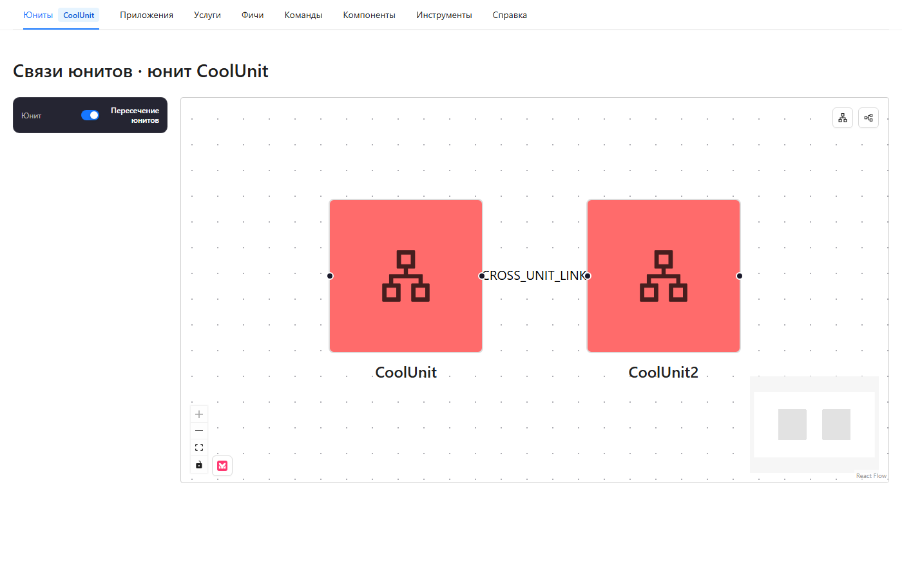
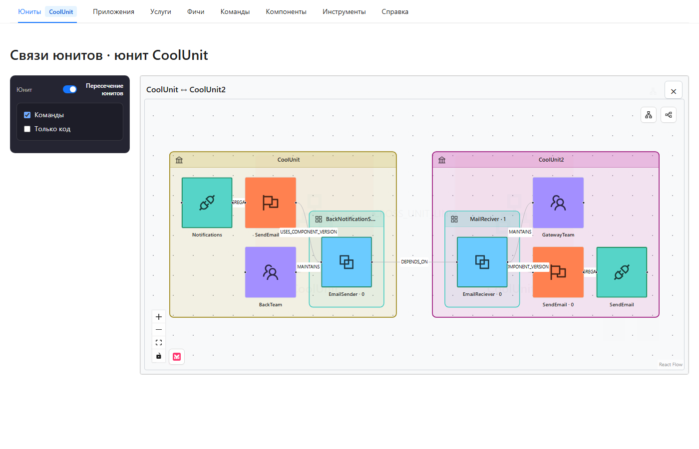

# Cross-unit и DEPENDS_ON

Связь юнитов строится не ребром «юнит — юнит», а зависимостью версии компонента одного юнита от версии компонента другого. На демо это мост **CoolUnit** и **CoolUnit2**: фича **SendEmail** в CoolUnit зависит от поставки в CoolUnit2.

## Предусловия

Откройте диаграмму юнита **CoolUnit**. Основной юнит в шапке может совпадать с ним.

## Обзор

1. В легенде диаграммы юнита переключитесь на **«Пересечение юнитов»**.
2. Заголовок станет **«Связи юнитов · юнит CoolUnit»**.
3. На холсте — CoolUnit и сосед **CoolUnit2**. Ребро между ними — обзор моста, не запись в базе.
4. Наведение на юнит подсвечивает это ребро.

## Детализация моста

1. Выберите ребро или мост между CoolUnit и CoolUnit2.
2. Поверх обзора откроется второй холст: команды, услуги, фичи, приложения и компоненты обеих сторон.
3. Компоненты лежат внутри приложений, приложения и остальные сущности — внутри рамки своего юнита.
4. Закрытие — крестик в правом верхнем углу оверлея.
5. Пока детализация открыта, в легенде есть **«Команды»** и **«Только код»**.

Правый клик **«Открыть в списке»** доступен для нод юнита, выбранного в шапке.

## Зависимость на диаграмме фичи

На опубликованной версии **SendEmail** (CoolUnit) включите **«Связь с другим юнитом»**: на холсте появится сторона CoolUnit2. У ребра `DEPENDS_ON` видна **стрелка** направления. Подробнее о легенде — в [фиче](./feature.md).

## Изменение данных

Новую зависимость заводят с **черновика** фичи, не с обзора юнитов:

1. Создайте версию фичи (**«Создать версию»**).
2. На диаграмме черновика правый клик по компоненту внутри приложения → **«Связь с другим юнитом»** (или **«Добавить связь»** для зависимости внутри юнита).
3. Укажите версию компонента-поставщика. Для чужого юнита компонент поставщика должен быть публичным контрактом.
4. Обратную связь (`B → A` при уже есть `A → B`) создают тем же пунктом **«Добавить связь»** / drag с другого конца — на холсте появятся **две разведённые** линии со стрелками.
5. Удаление видимой связи на черновике — правый клик по **нужной** линии → **«Удалить связь»**.

На опубликованной версии эти пункты меню скрыты. После экспериментов верните демо: `npm run db:reset`.

## Связанные статьи

- [Диаграммы и impact](./diagrams.md)
- [Фича и состав](./feature.md)
- [Сценарии по ролям](../scenarios.md)
