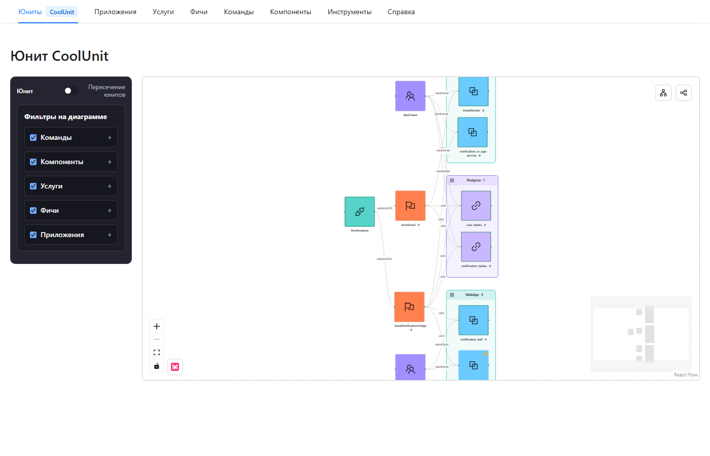
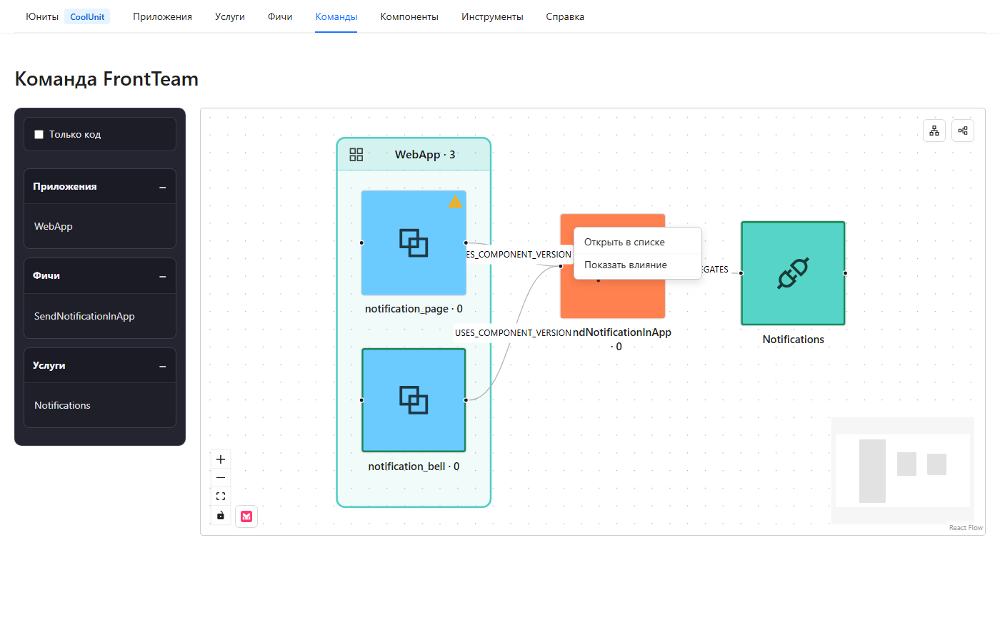
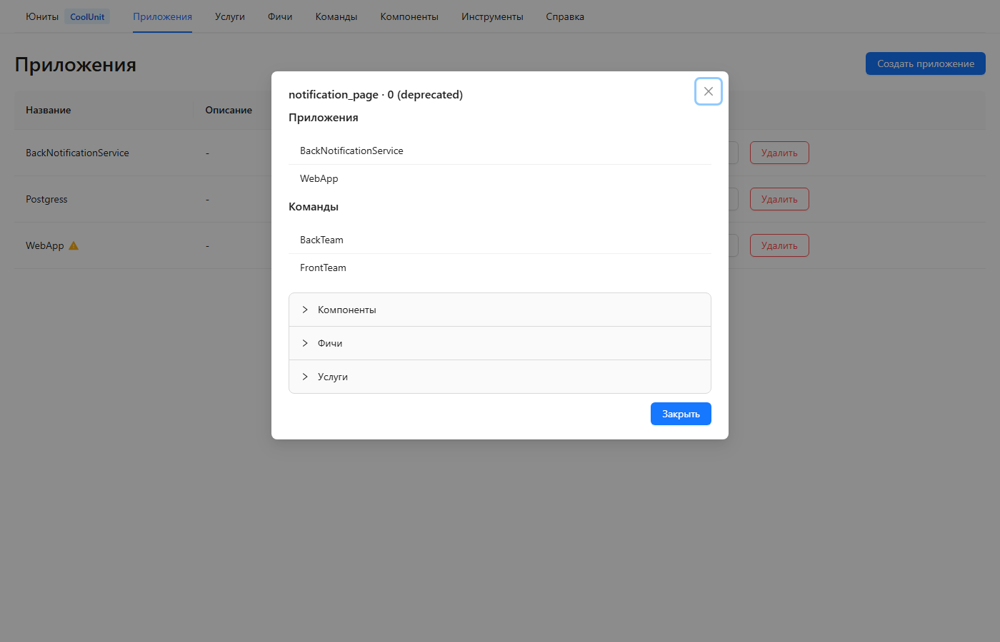
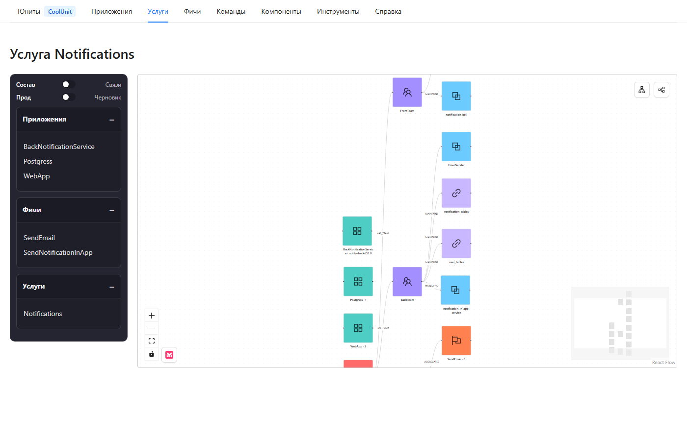

# Диаграммы и impact

Диаграммы показывают связи выбранного юнита. На демо начните с **CoolUnit**.

## Предусловия

Основной юнит — **CoolUnit** ([быстрый старт](../quick-start.md)).

## Диаграмма юнита

1. На **«Юниты»** откройте диаграмму **CoolUnit** или перейдите из шапки, если юнит уже основной.
2. На холсте — команды, услуга **Notifications**, фичи и приложения с компонентами текущего релиза. Самого юнита на холсте нет.
3. В легенде слева — **«Фильтры на диаграмме»**: команды, компоненты, услуги, функционалы, приложения. Скрытие не запрашивает данные заново.
4. Наведение на ноду подсвечивает её ближайшие связи.
5. Пункта **«Показать влияние»** на этой диаграмме нет. Влияние смотрите с диаграммы команды, услуги или компонента.
6. Переключатель **«Юнит»** / **«Пересечение юнитов»** в легенде ведёт на обзор связей с другими юнитами — см. [cross-unit](./cross-unit.md).

Правый клик по ноде своего юнита — **«Открыть в списке»**: откроется список с подсветкой этой строки.

## Влияние

1. Откройте диаграмму команды **FrontTeam** или **BackTeam** (**«Команды»** → диаграмма).
2. Правый клик по ноде → **«Показать влияние»**.
3. Затронутые ноды подсвечиваются на том же холсте: компоненты, приложения, фичи, услуги, команды.
4. **«Сбросить влияние»** возвращает обычный вид.

На снимке открыто контекстное меню ноды. После выбора пункта подсветка остаётся на холсте.

На диаграмме команды чекбокс **«Только код»** оставляет приложения, компоненты и зависимости между ними.

Тот же пункт **«Показать влияние»** есть на диаграмме услуги и на диаграмме версии фичи (не в режиме сравнения).

## Предупреждения о статусе

Жёлтый треугольник на списке приложений и на составе текущего релиза означает устаревшую или неактивную версию компонента.

1. Откройте **«Приложения»**.
2. Если у названия есть треугольник, нажмите его.
3. В модалке — приложения и команды для связи, а также связанные компоненты, фичи и услуги.

## Услуга

1. Откройте **«Услуги»** и **Notifications**.
2. На диаграмме видны фичи **SendEmail** и **SendNotificationInApp** и приложения, в которых лежат их компоненты.
3. Состав можно смотреть и на странице услуги.

Добавить или снять фичу можно на странице услуги и на её диаграмме. Снятие помечает связь удалённой и может спросить причину. На демо эти кнопки лучше не подтверждать: снимок ниже — просмотр.

Как компоненты фич связаны между приложениями — на [диаграмме версии фичи](./feature.md).

## Связанные статьи

- [Фича и состав](./feature.md)
- [Cross-unit и DEPENDS_ON](./cross-unit.md)
- [Сценарии по ролям](../scenarios.md)
