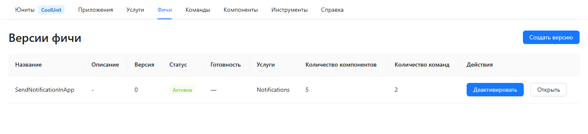
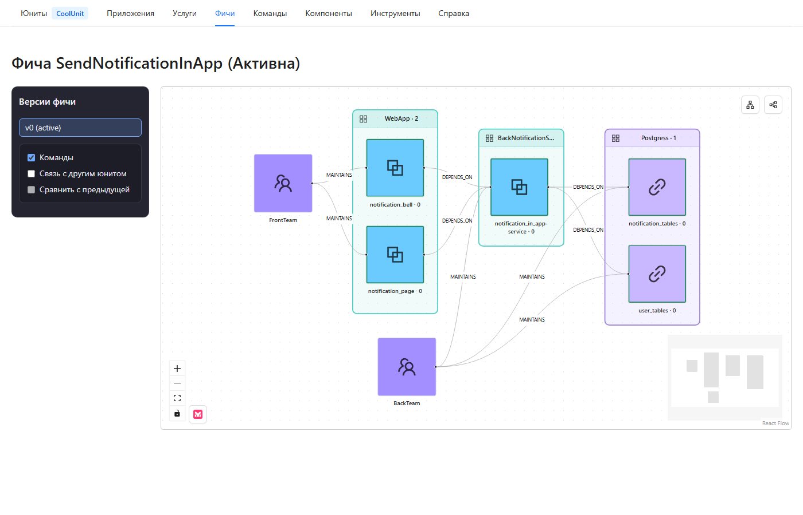

# Фича и состав

Фича описывает функционал и связывает версии компонентов. На демо в **CoolUnit** смотрите **SendNotificationInApp** и **SendEmail** услуги **Notifications**.

## Предусловия

Основной юнит — **CoolUnit**. В демо у этих фич есть опубликованная версия со статусом **active** и нет черновика.

## Список версий

1. Откройте **«Фичи»** и строку **SendNotificationInApp**.
2. В таблице — версии, статус и счётчики компонентов и команд.
3. У опубликованной версии нет бейджа готовности к проду: он появляется только у черновика.
4. Диаграмма версии открывается кнопкой **«Открыть»** в строке.

## Диаграмма опубликованной версии

1. Откройте диаграмму версии **SendNotificationInApp**.
2. На холсте — приложения-контейнеры и компоненты вида «имя · версия». Сама фича и услуга на холсте не рисуются: имя и статус — в заголовке страницы.
3. Рёбра между компонентами одного юнита видны сразу. У зависимости `DEPENDS_ON` на холсте видна **стрелка** направления (потребитель → поставщик).
4. В легенде чекбокс **«Связь с другим юнитом»** (по умолчанию выключен). Включите его, чтобы увидеть чужие приложения и компоненты, если у версии есть такая зависимость. У **SendEmail** в CoolUnit связь уходит в CoolUnit2.
5. Чекбокс **«Команды»** показывает или скрывает команды на холсте.
6. **«Сравнить с предыдущей»** на демо недоступен: у опубликованной версии нет предыдущей версии фичи.

### Направление и обратная зависимость

Между двумя компонентами можно завести **две** направленные связи: `A → B` и `B → A` (например отправили данные и приняли результат после обработки). Это два отдельных ребра: на холсте две **разведённые** линии со стрелками. Обратную связь создают тем же действием **«Добавить связь»** (или соединением handles) с **другого** конца пары. Удаление на черновике — правый клик по **нужной** линии → **«Удалить связь»** (вторая линия не трогается).

С опубликованной версии состав не меняется: нет пунктов добавить компонент, поднять версию или исключить из фичи.

## Изменение данных

На демо этих экранов нет, пока не создан черновик. Порядок такой:

1. На странице фичи нажмите **«Создать версию»**. В модалке **«Новая версия фичи»** подтвердите номер. Появится черновик.
2. Откройте диаграмму черновика. В меню холста — **«Создать компонент»** и **«Добавить компонент»**. После выбора версии компонента всегда нужно указать приложение: Select доступен, если приложений больше одного; если приложений нет или оно одно — Select недоступен, но кнопка **«Создать приложение»** всегда есть. Повторно добавить **ту же версию** компонента в **то же** приложение нельзя: система покажет «Такая версия компонента уже добавлена в это приложение». Другую версию того же компонента или ту же версию в другом приложении добавить можно.
3. Правый клик по компоненту внутри приложения: **«Добавить связь»**, **«Связь с другим юнитом»**, **«Исключить из фичи»**, **«Поднять версию»**. Поднять версию нельзя, если у выбранной версии компонента уже статус черновика. Чтобы добавить связь в обратную сторону к уже существующей зависимости, откройте **«Добавить связь»** (или протяните handle) с другого компонента пары — отдельного пункта меню нет.
4. Кнопка **«Проверить готовность»** показывает, можно ли публиковать черновик. Пустой черновик без компонентов не готов. Кнопка **«Активировать»** на странице версий недоступна, пока нет связанных компонентов. Когда все нужные версии компонентов на проде, черновик можно перевести в **active**.
5. **«Сравнить с предыдущей»** включается, когда у открытой версии есть непосредственный предшественник. Новые элементы подсвечиваются зелёным, исчезнувшие — красным. Пока сравнение включено, холст только для просмотра.

После правок демо возвращается командой `npm run db:reset`.

## Связанные статьи

- [Диаграммы и impact](./diagrams.md)
- [Cross-unit и DEPENDS_ON](./cross-unit.md)
- [Релиз приложения](./application-release.md)
