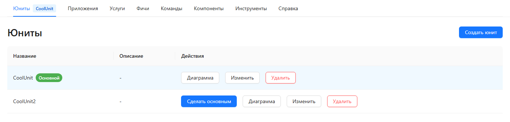
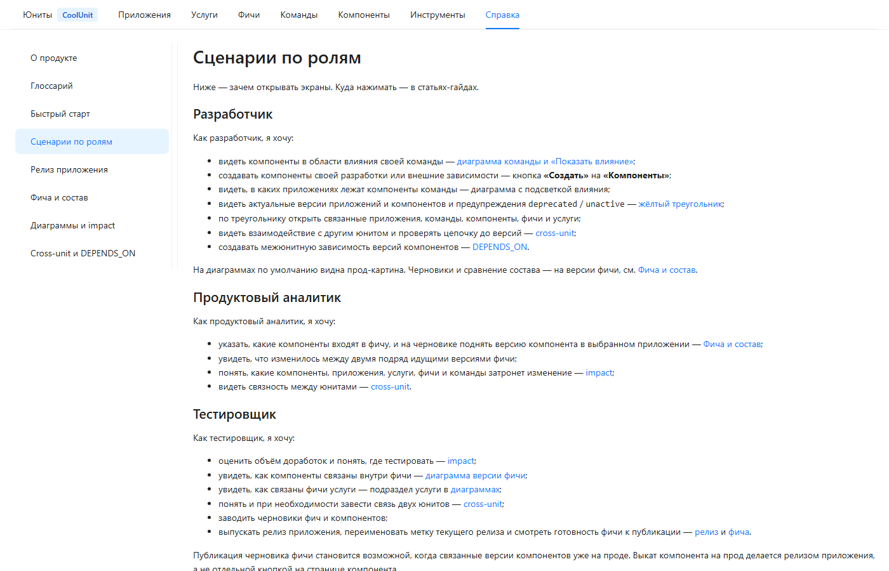

# Быстрый старт

Демо-граф уже содержит два юнита: **CoolUnit** и **CoolUnit2**. Дальнейшие статьи опираются на эти имена.

## Первые шаги

1. Откройте приложение и пункт меню **«Юниты»**.
2. В строке **CoolUnit** нажмите **«Сделать основным»**.
3. В шапке рядом с **«Юниты»** появится метка с именем юнита. Списки услуг, фич, приложений и компонентов фильтруются по ней.

Справка открывается пунктом **«Справка»** в верхнем меню и не зависит от выбранного юнита.

## Что есть в демо

**CoolUnit**

- Услуга **Notifications** (фичи **SendEmail** и **SendNotificationInApp**)
- Приложения **WebApp**, **BackNotificationService**, **Postgress**
- Команды **FrontTeam** и **BackTeam**

**CoolUnit2**

- Услуга и фича **SendEmail**
- Приложения **MailReciver**, **EmailGate**, **RabbitMQ**
- Связь с CoolUnit через зависимость версий компонентов

## Куда дальше

- [Сценарии по ролям](./scenarios.md)
- [Диаграммы и impact](./guides/diagrams.md)
- [Фича и состав](./guides/feature.md)
- [Релиз приложения](./guides/application-release.md)
- [Cross-unit и DEPENDS_ON](./guides/cross-unit.md)
