# Быстрый старт

На странице рассмотрим процесс создания юнита, фичи и ее обновления.

## 1. Создание юнита

1. Откройте пункт меню **«Юниты»**.
2. Нажмите **«Создать юнит»**, в открывшемся окне укажите название и при желании описание.
3. Сохраните юнит.

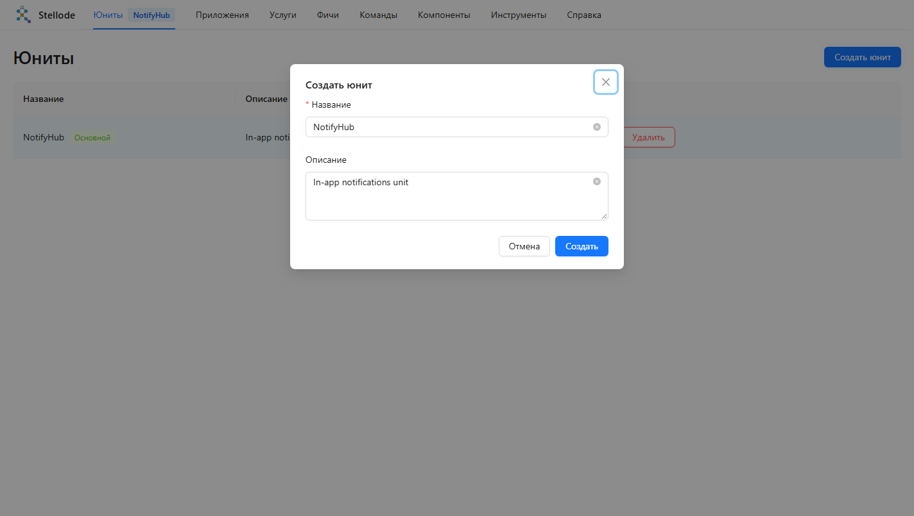

4. В строке юнита нажмите **«Сделать основным»**.

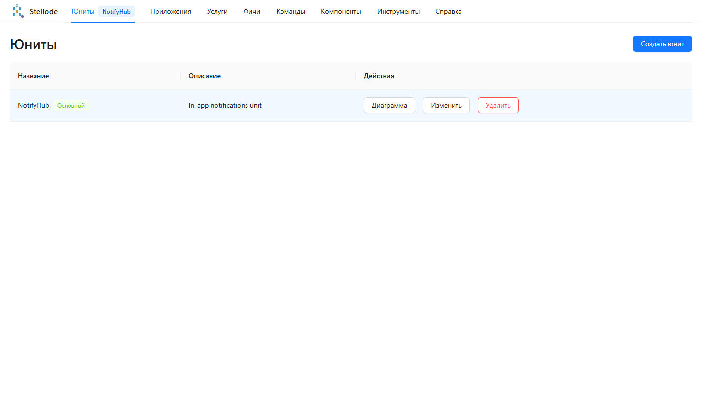

> [!WARNING]
> Без основного юнита списки услуг, фич, приложений, команд и компонентов не фильтруются по контексту, а создание многих сущностей блокируется сообщением «Выберите основной юнит». Метка с именем юнита в шапке рядом с **«Юниты»** показывает текущий контекст.
> Основной юнит отображается в пункте меню "Юниты" и в таблице возле названия юнита

## 2. Создание команды

1. Откройте пункт меню **«Команды»**
2. Нажмите **«Создать команду**, в открывшемся окне укажите название и при желании описание.
3. Сохраните команду

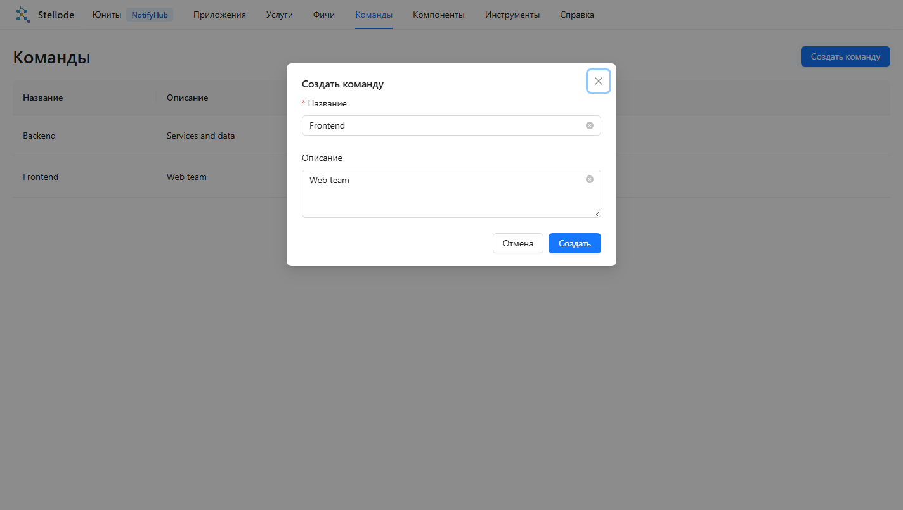

## 3. Приложения

1. Откройте **«Приложения»** → **«Создать приложение»**.
2. Создайте **WebApp**, **NotificationBackend** и **Postgres**.

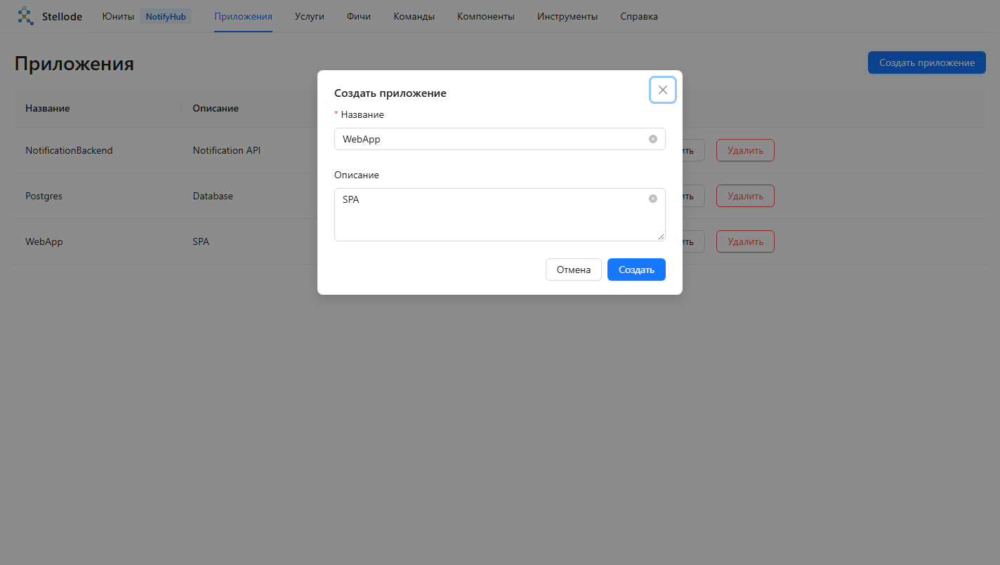

У нового приложения ещё нет релиза: колонка версии пуста, пока не выполнен визард **«Новый релиз»**.

## 4. Услуга

1. Откройте **«Услуги»** → **«Создать услугу»**.
2. Создайте **Notifications**.

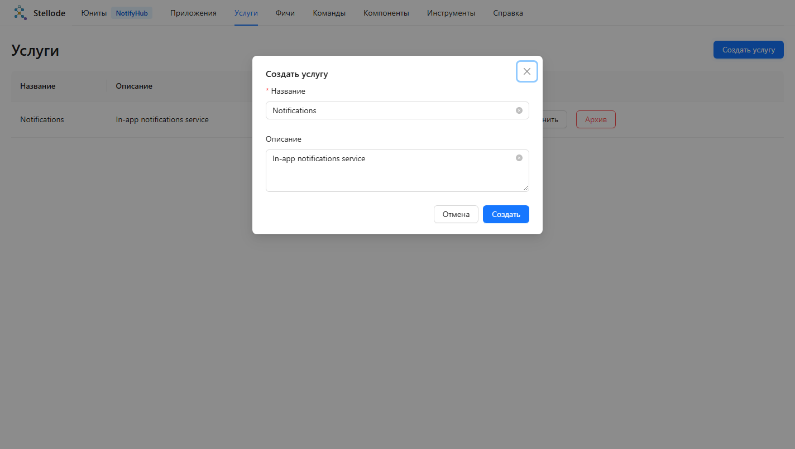

## 5. Фича и привязка к услуге

1. Откройте **«Фичи»** → **«Создать фичу»**.
2. Укажите **SendInAppNotification**.
3. В блоке услуг отметьте **Notifications** и создайте фичу.

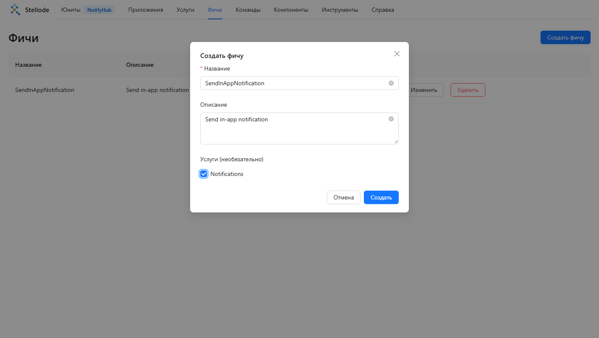

> [!WARNING]
> Фичу можно сразу включить в услугу при создании. Тот же состав можно собрать позже: на странице услуги — **«Управление фичами»**, либо с диаграммы услуги.

При создании фичи автоматически появляется черновик версии. Система предлагает следующий номер; его можно заменить произвольной строкой (например `1.0.0`), если метка уникальна в пределах фичи.

## 6. Компоненты

Создавайте компоненты со страницы **«Компоненты»** → **«Создать компонент»**.

Для первой итерации заведите четыре компонента (страницу уведомлений пока не создаём):

| Компонент | Команда | Тип |
| --------- | ------- | --- |
| NotificationBell | Frontend | своя разработка |
| NotificationSender | Backend | своя разработка |
| UserTable | Backend | внешняя зависимость |
| NotificationTable | Backend | внешняя зависимость |

Поля модалки:

- **Название** — уникальное имя в юните.
- **Описание** — необязательный текст.
- **Зависимость (dependency)** — внешняя зависимость (БД, вендор), а не код своей команды.
- **Публичный контракт** — для cross-unit; в этом сценарии оставляем выключенным.
- **Команда** — кто сопровождает компонент (`MAINTAINS`).

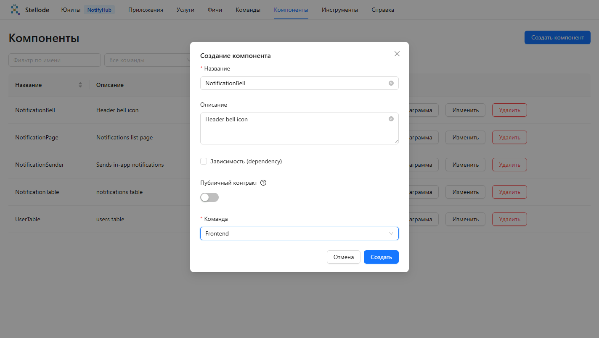

> [!NOTE]
> Компонент можно создать и прямо на диаграмме черновика фичи (**«Создать компонент»** в меню холста) — см. [шаг 7](#7-состав-черновика-и-зависимости).

## 7. Состав черновика и зависимости

1. Откройте фичу **SendInAppNotification** → строку черновика `1.0.0` → **«Открыть»** (диаграмма версии).
2. Через **«Добавить компонент»** / **«Создать компонент»** включите в состав:
   - NotificationBell → приложение **WebApp**;
   - NotificationSender → **NotificationBackend**;
   - UserTable и NotificationTable → **Postgres**.
3. Связи `DEPENDS_ON` (потребитель → поставщик):
   - NotificationBell → NotificationSender;
   - NotificationSender → UserTable;
   - NotificationSender → NotificationTable.

Первый скрин состава — с включённым чекбоксом **«Команды»**. Дальше в сценарии команды на холсте можно выключить.

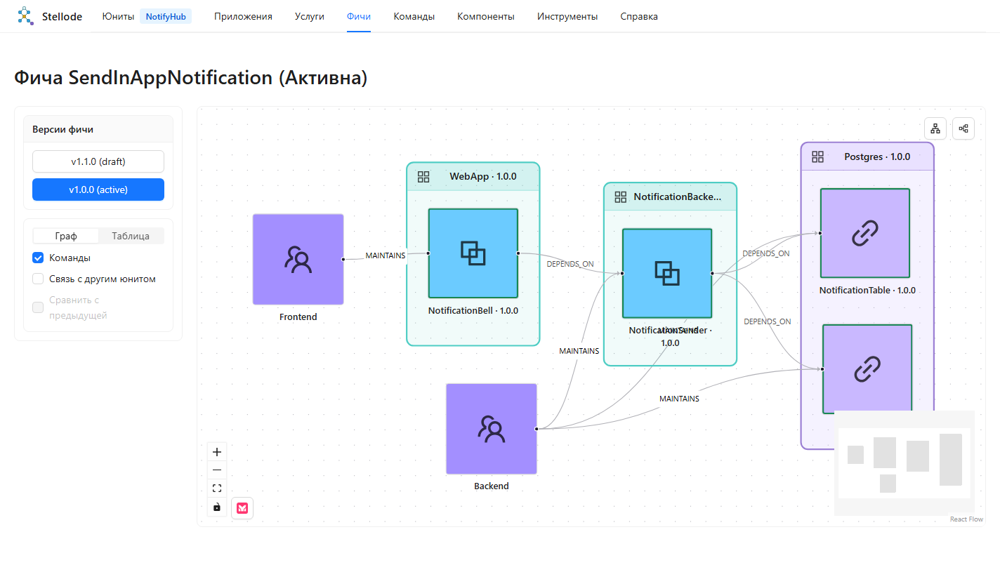

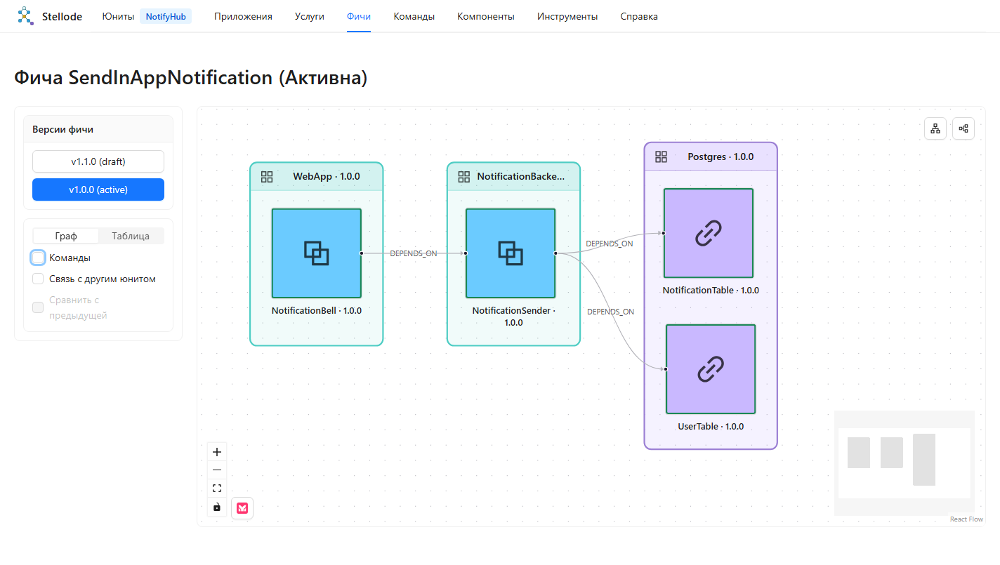

## 8. Проверка готовности до релизов

На диаграмме черновика нажмите **«Проверить готовность»**. Пока у приложений нет `current`-релиза с этими версиями компонентов, привязки помечены как не готовые (например «нет в релизе»).

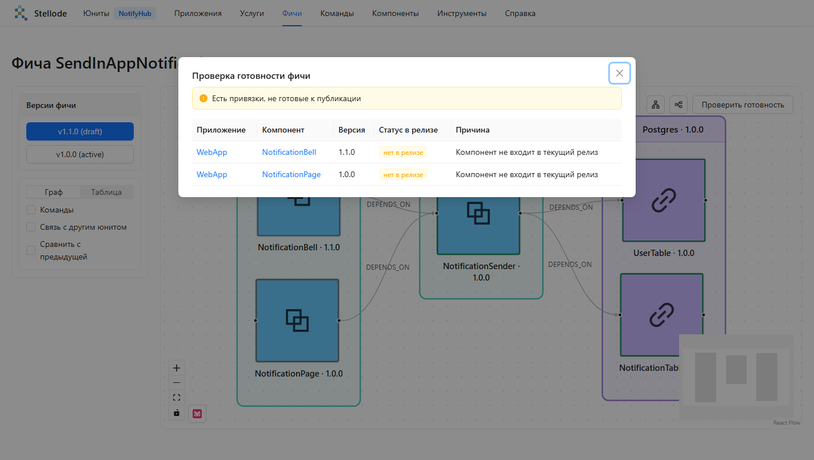

## 9. Первый релиз WebApp

1. **«Приложения»** → в строке **WebApp** → **«Новый релиз»**.
2. **Шаг 1. Состав:** **«Добавить компоненты»**, выберите **NotificationBell** `1.0.0`.

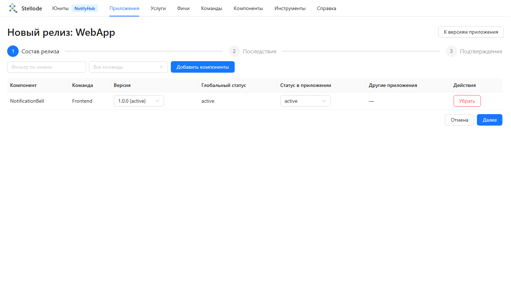

3. **Шаг 2. Последствия:** что изменится в приложении и глобально (публикация `draft → active` у Bell).

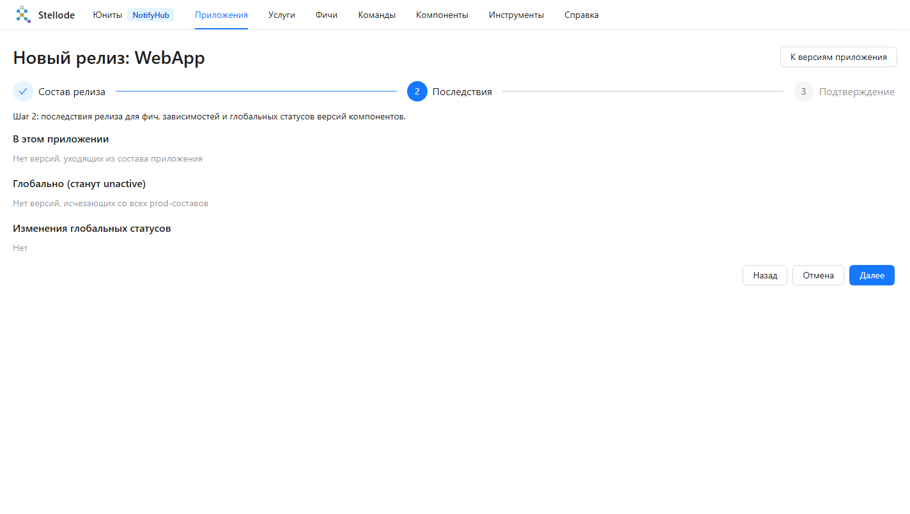

4. **Шаг 3. Подтверждение:** метка версии `1.0.0` → **«Выпустить»**.

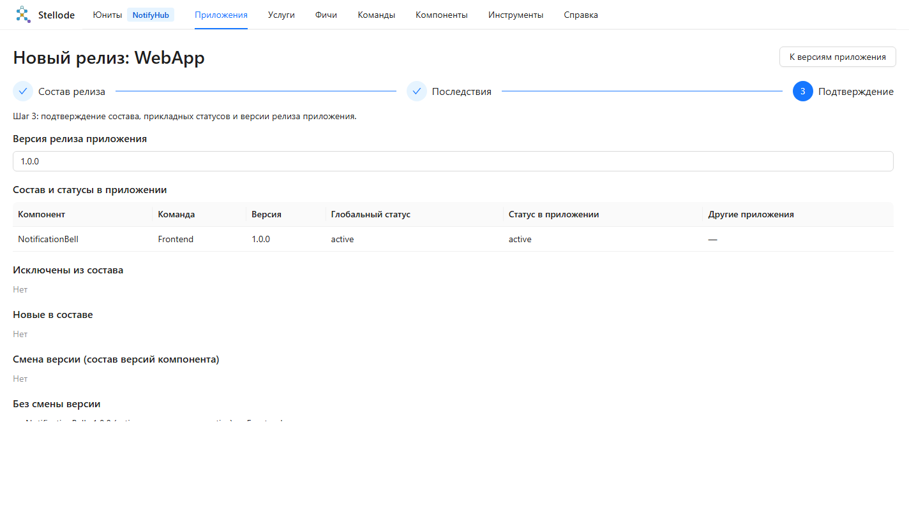

## 10. Релизы NotificationBackend и Postgres

Аналогично визарду WebApp выпустите:

- **NotificationBackend** `1.0.0` с **NotificationSender**;
- **Postgres** `1.0.0` с **UserTable** и **NotificationTable**.

Отдельные скрины для этих релизов не нужны: шаги те же.

## 11. Активация фичи

1. Откройте страницу версий фичи **SendInAppNotification**.
2. У черновика `1.0.0`, когда готовность позволяет, нажмите **«Активировать»**.

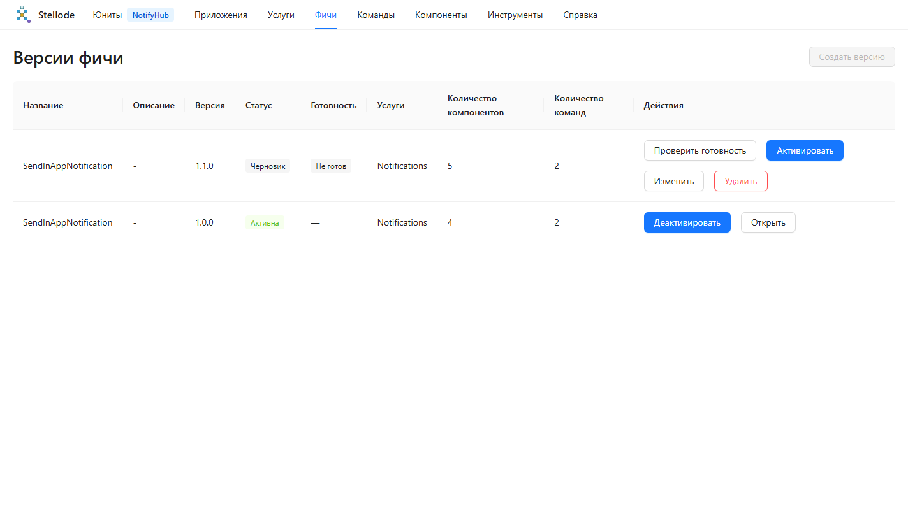

> [!WARNING]
> Переход `draft → active` фиксирует снимок текущих релизов приложений (`PINNED_TO_APPLICATION_VERSION`): какие `current`-версии приложений были на момент публикации фичи. Последующие релизы приложений этот снимок не меняют.

## 12. Вторая версия фичи

1. **«Создать версию»** с меткой `1.1.0` (черновик наследует состав `1.0.0`).
2. На **«Компоненты»** создайте **NotificationPage** (Frontend, своя разработка).
3. На диаграмме черновика `1.1.0`:
   - добавьте NotificationPage в **WebApp**;
   - связь NotificationPage → NotificationSender;
   - у NotificationBell — **«Поднять версию»** до `1.1.0`.

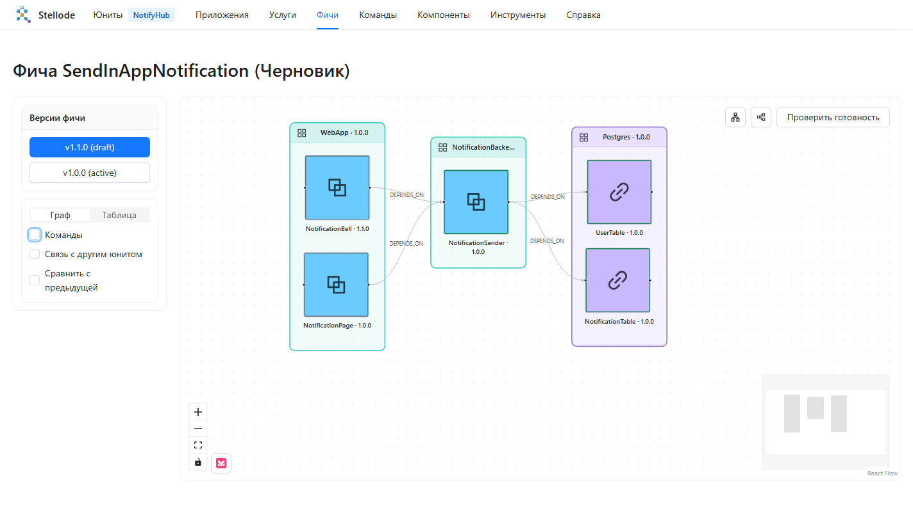

## 13. Проверка готовности 1.1.0

Снова **«Проверить готовность»**: Bell `1.1.0` и Page ещё не в `current` WebApp — статус «нет в релизе».

## 14. Сравнение с предыдущей версией

Включите **«Сравнить с предыдущей»** на диаграмме `1.1.0`.

- **Зелёный** — появилось относительно предыдущей версии (новая страница, новая версия колокольчика, новые связи).
- **Красный** — исчезло относительно предыдущей (старая версия компонента, снятая связь).

Активировать `1.1.0` в этом сценарии **не** нужно: сравнение смотрим на черновике.

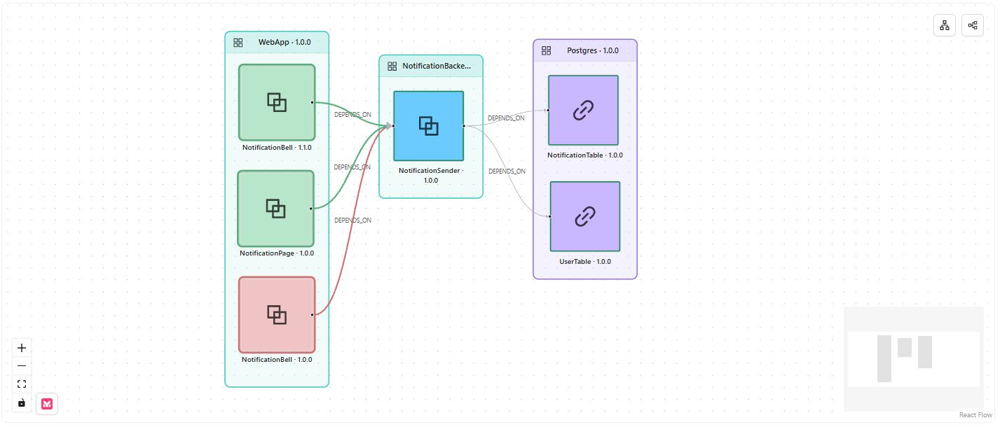

## 15. Второй релиз WebApp

1. **WebApp** → **«Новый релиз»**.
2. В составе поднимите NotificationBell до `1.1.0` и добавьте NotificationPage `1.0.0`.
3. Пройдите шаги последствий и подтверждения с меткой `1.1.0` → **«Выпустить»**.

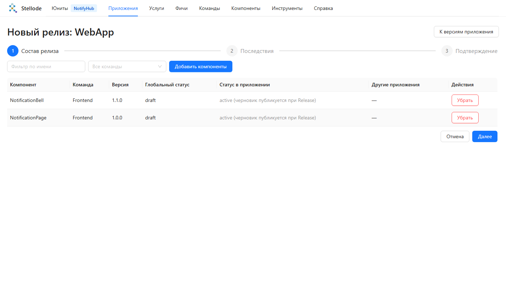

После этого проверка готовности черновика фичи `1.1.0` станет положительной; публикацию фичи можно отложить.

## Куда дальше

- [Сценарии по ролям](./scenarios.md)
- [Фича и состав](./guides/feature.md)
- [Релиз приложения](./guides/application-release.md)
- [Компонент и версии](./guides/components.md)
- [Диаграммы и impact](./guides/diagrams.md)
- [Cross-unit и DEPENDS_ON](./guides/cross-unit.md)
