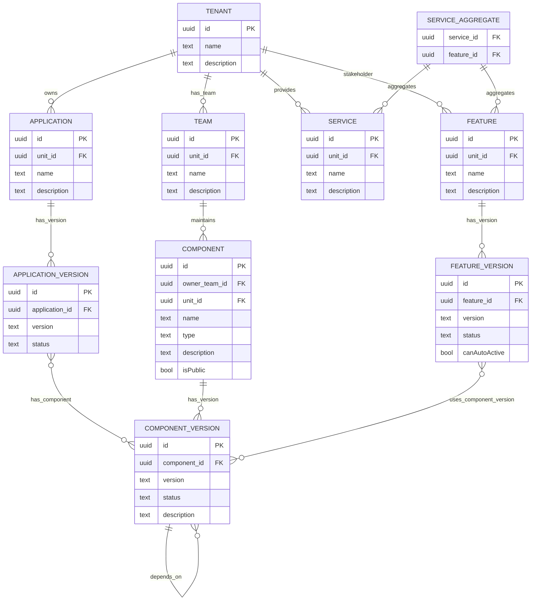
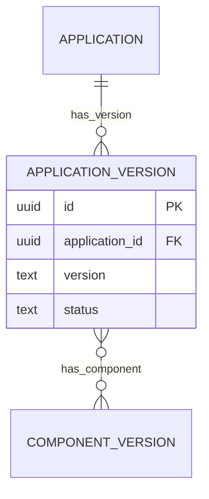
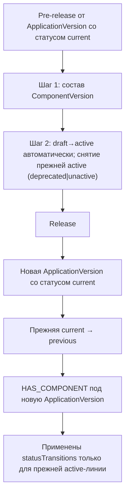

# ER-диаграмма (иллюстрация)

Диаграммы ниже **иллюстративные** (логическая проекция схемы). Нормативные правила, state machine, изоляция по юнитам, жизненный цикл версий и ограничения на связи описаны в **[spec.md](./spec.md)**. Прод-семантика статусов **`ComponentVersion`**, гибрид черновик/опубликованная линия у **фичи**, эпик и автопереход черновика **`FeatureVersion`** в `active` — в **spec.md** §3.0.1–§3.0.2 и §6.

**Диаграммы в продукте (граф зависимостей):** на экране могут отображаться **и родительские сущности**, и **версии** (`FeatureVersion`, `ComponentVersion`, `ApplicationVersion`), чтобы было видно полный путь. При этом **межюнитная интеграция** в данных задаётся **ребрами между версиями компонентов** — **`DEPENDS_ON`** (и правила **[spec.md §8](./spec.md)**); отдельного ребра «два `Unit`» в модели нет. ER ниже не показывает все комбинации узлов на одном холсте — это схема сущностей и ключевых связей.

---

## ER-диаграмма

Межсервисный и межфичевый контракт в графе — это ребро **`DEPENDS_ON`** между **`COMPONENT_VERSION`** с контекстом на отношении (сервисы, приложения, фичи); отдельные сущности «соединения фич» не используются.

Логически на одну пару сервис–фича может приходиться **несколько** строк `SERVICE_AGGREGATE` (история снятий): в Neo4j это несколько рёбер **`AGGREGATES`**, у снятых — **`deleted: true`**; нормативные правила — **[spec.md §2.1](./spec.md)**. Опциональная причина снятия в UI хранится на ребре как **`deleted_reason`** (см. [aggregates-api.md](./aggregates-api.md)).

Типы полей для справки: `COMPONENT_VERSION.status` и `FEATURE_VERSION.status` — `draft | active | deprecated | unactive`; `APPLICATION_VERSION.status` — `current | previous` (черновика `draft` у версий приложения нет). `FEATURE_VERSION.canAutoActive` — флаг автоперехода черновика в `active`; `readyToProduction` — вычисляемый признак, не часть state machine (см. [spec.md §6](./spec.md)). `COMPONENT.type` — `component | dependency`; `COMPONENT.isPublic` — политика публичности для cross-unit (см. [spec.md §8](./spec.md)). Состав релиза приложения в графе — ребро **`HAS_COMPONENT`** от **`ApplicationVersion`** к **`ComponentVersion`** (см. [spec.md §5](./spec.md)). Ребро `depends_on` соответствует **`DEPENDS_ON`** в графе; контекст (сервисы, приложения, фичи) хранится в свойствах отношения.

---

## Релиз Application (логическая проекция)

### Процесс pre-release (схема)

Поведение шагов и инварианты — в [spec.md](./spec.md) (§5 и §5.1). **Первый релиз приложения** (до появления любой `ApplicationVersion`): шаг 1 начинается с **пустого** состава; после Release создаётся **`ApplicationVersion(current)`** с номером **1** без предшественника по `INHERITED` и без шага «прежняя `current` → `previous`». Перескок вперёд по `INHERITED` относится к **замене** версии компонента, уже входящего в состав `current`. **Ввод нового** компонента в приложение — по правилам §5.1 (в т.ч. допустимы `active` и `deprecated` без предшествующей строки в `current`).
Уточнение по release: `draft`→`active` выполняется сервером при Release; массив `statusTransitions` в API содержит **только** перевод прежней `active`-линии в `deprecated` или `unactive` (§5.1); для первого релиза массив **пуст**.
